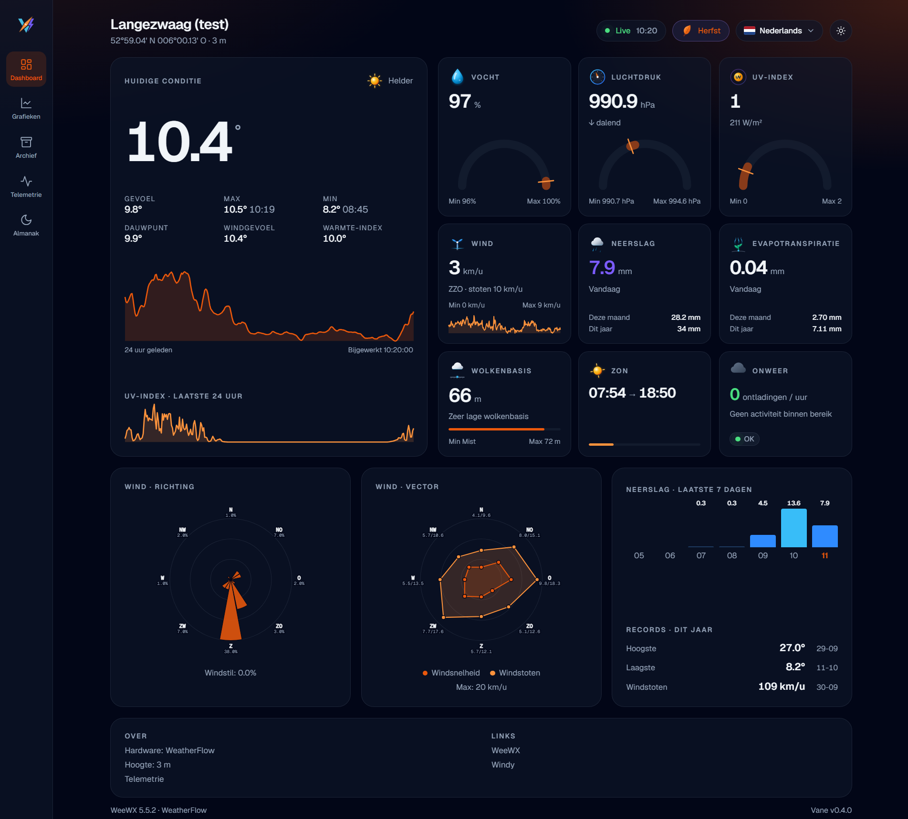

# Vane — WeeWX Theme

A custom, modern WeeWX skin: light/dark, multilingual, lightweight
client-side charts, and sensor-agnostic (works unchanged across a station
swap, e.g. WeatherFlow Tempest → Ecowitt). Successor to
[NeoWX Material](https://neoground.com/en/open-source/neowx-material), not
as a copy but as a lighter, more modern build of its own.

## Status

Working and tested against a real WeeWX install with live WeatherFlow
Tempest data (not just the Simulator): Dashboard, Graphs, Archive, Telemetry
and Almanac are all there. See `docs/DASHBOARD_EXPANSION_PLAN.md` for the
status per component.



## Features

- **Dashboard** with sensor-agnostic tiles, gauges, wind rose, wind-vector
  radar, rain bars, records and live updates (polling, or MQTT — see below).
- **Graphs** (uPlot) per day/week/month/year/all time with CSV export.
- **Archive** with the current month, every month of the recorded history
  (its own page per month, with rain calendar and day table), years &
  months overview, all-time records and NOAA reports.
- **Telemetry** (battery, signal, storage, services) and **Almanac** (sun
  arc, twilight, moon phases, day length through the year, seasons).
- **Three languages** out of the box — Dutch, English, German — each a
  fully generated report with a language switcher; more can be added.
- **Light/dark theme** and a **seasonal accent colour** (spring green,
  summer amber, autumn copper, winter ice blue) that follows the current
  season site-wide, or a fixed colour of your choice.
- **Animated weather icons**: one filled SVG set that animates on its own,
  plus matching Lottie animations generated from those same SVGs
  (`tools/svg2lottie.py`) for hover and the current condition. Respects
  "reduce motion".

## Supported extensions (optional)

Vane works with a plain WeeWX install. When one of these extensions is
installed, Vane picks it up automatically and shows extra content — it
contains none of their code and never requires them.

| Extension | What Vane adds when it's installed |
|---|---|
| [weewx-skyfield-almanac](https://github.com/roe-dl/weewx-skyfield-almanac) | Almanac: *Moon & Earth* card (Moon/Sun constellation, Moon distance, solar time, equation of time, perigee/apogee with supermoon badge, perihelion/aphelion) and a *Planets* card (rise/set, above horizon, Venus/Mercury phase). Also replaces the PyEphem almanac with up-to-date JPL data. |
| [weewx-skymap-almanac](https://github.com/roe-dl/weewx-skymap-almanac) | Almanac: live *Sky now* map of the sky above the station, and the Moon icon shows the real phase **and tilt**. Requires the Skyfield almanac. |
| [weewx-mqtt](https://github.com/matthewwall/weewx-mqtt) | Dashboard: live values over MQTT-over-websockets instead of polling (`[Vane][[MQTT]]` in `skin.conf`). Any broker with a websocket listener. |

The almanac extensions are GPL-3.0 and installed separately; see
[INSTALL.md](INSTALL.md) §6 for install notes (incl. the `requests`
dependency the Skyfield almanac needs on pip installs).

## Installing

See **[INSTALL.md](INSTALL.md)** for the full install/update instructions
(building the zip, pip vs. package install, updating).

Short version:

```bash
python build.py
weectl extension install dist/vane-<version>.zip
sudo systemctl restart weewx
```

## Directory structure

- [`docs/`](docs/) — the plans and decisions (see below)
- [`skins/Vane/`](skins/Vane/) — the actual WeeWX skin (Cheetah templates, CSS, JS)
- [`bin/user/vane_extras.py`](bin/user/vane_extras.py) — search-list extension
  (sensor detection, wind-rose/wind-vector calculations, archive history,
  season, almanac helpers, optional-extension detection)
- [`install.py`](install.py) — WeeWX `ExtensionInstaller`
- [`tools/svg2lottie.py`](tools/svg2lottie.py) — regenerates the Lottie
  animations from the animated SVG icons (dev only, needs `pip install lottie`)
- [`build.py`](build.py) — builds the installable zip from `install.py`'s own file list
- [`design/`](design/) — design work: `mockup-handoff/` (Claude Design export),
  `chart-test/` (uPlot vs. own-SVG benchmark), `wsl-test-output/` (generated
  test output, git-ignored)
- [`reference/`](reference/) — input material, not part of Vane itself
  (a live `weewx.conf` with passwords, the full source of the NeoWX
  Material theme) — see `reference/README.md`. Sensitive/third-party files
  in here are **git-ignored**.

## Documentation

- [`docs/DESIGN_PLAN.md`](docs/DESIGN_PLAN.md) — visual design: colors, typography,
  components, pages, sensor-agnostic tile design.
- [`docs/THEME_PLAN.md`](docs/THEME_PLAN.md) — technical plan: WeeWX skin architecture,
  sensor-agnostic `[[Tiles]]` configuration, data strategy (uPlot), i18n, distribution.
- [`docs/DASHBOARD_EXPANSION_PLAN.md`](docs/DASHBOARD_EXPANSION_PLAN.md) —
  research into other WeeWX skins/weather sites, a phased expansion plan and
  the status of what's actually been built from it.
- [`docs/MOCKUP_REVIEW.md`](docs/MOCKUP_REVIEW.md) — findings on the
  original Claude Design mockup.
- [`INSTALL.md`](INSTALL.md) — install/update.

## References / competitive research

| Skin | Key trait | Charting |
|---|---|---|
| [NeoWX Material](https://neoground.com/en/open-source/neowx-material) | current theme, 19 color themes, mature | ApexCharts |
| [weewx-belchertown](https://github.com/poblabs/weewx-belchertown) | live updates via MQTT/websockets, forecast | Highcharts (license!) |
| [Weather34](https://github.com/Drealine/weewx-Weather34) | gauge-driven templates | own |
| [weewx-wdc](https://github.com/Daveiano/weewx-wdc) | IBM Carbon + Nivo, lots of widgets | Nivo (React stack) |
| [weewx-aganetwx](https://github.com/aganet/weewx-aganetwx) | i18n, dark mode, sensor-agnostic | Apache ECharts |

See `docs/THEME_PLAN.md` and `docs/DASHBOARD_EXPANSION_PLAN.md` for the full
trade-off and chosen direction.

## Requirements

- WeeWX 5.x (the optional Skymap almanac needs 5.3+)
- Python 3.7+ (for the skin generator/installer)
- No build step for the frontend (vanilla JS, no framework) — keeps it light
  and easy to maintain.

## License

[MIT](LICENSE) — same as most reference skins above. Vane also uses a small
number of MIT/OFL-licensed third-party libraries (uPlot, lottie-web,
MQTT.js, flag-icons, the Geist font; the icon set was originally based on
Meteocons) — see
[THIRD-PARTY-LICENSES.md](THIRD-PARTY-LICENSES.md) for details.
